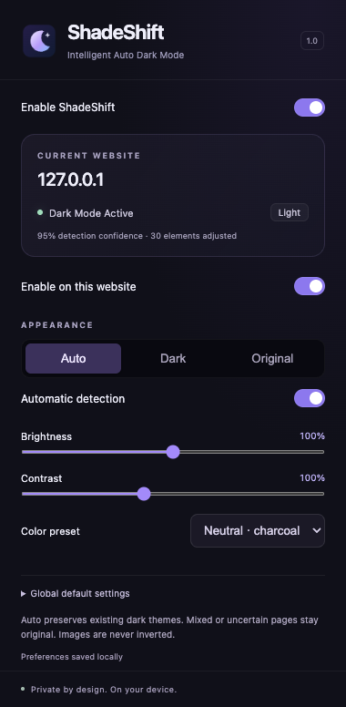
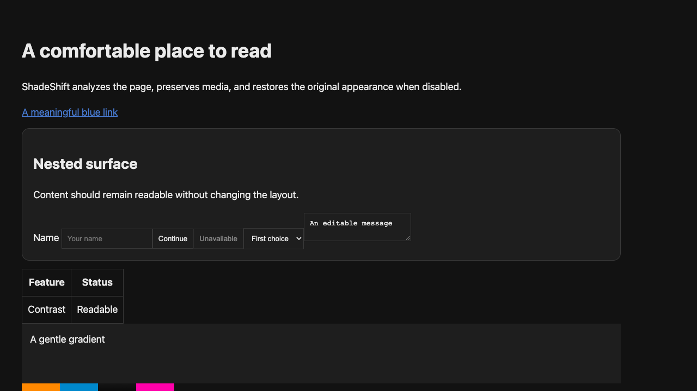

# ShadeShift — Intelligent Auto Dark Mode

A privacy-first Chrome extension that measures visible page colors, darkens light websites, and leaves good native dark themes alone. Built with TypeScript, React, Vite and Manifest V3. Everything runs locally; no account, API key, backend or tracking.

**Source:** https://github.com/K3V88/shadeshift-extension · **License:** MIT, K3V88

## Features

- Area-weighted viewport sampling with Light, Dark, Mixed and Unknown classifications and confidence scores.
- Automatic, Always Dark and Original modes, with exact-host overrides and exclusions.
- Reversible computed-color transformations; no page-wide inversion, brightness filter, layout rewrite or media manipulation.
- Neutral, Midnight and Warm palettes; six configurable custom colors, brightness and contrast controls.
- Dynamic DOM, common SPA navigation, same-origin frames and reachable open shadow roots.
- Locally persistent settings, accessible popup controls and reduced-motion support.
- Original crescent-moon icons at 16, 32, 48 and 128 pixels.

## Screenshots





Screenshots use fictional local fixtures. They do not imply compatibility with every website.

## Install in Chrome

Use Node.js **22.12 or newer** (Node 24 LTS recommended) and npm.

1. Clone this repository and open its directory.
2. Run `npm install` (or `npm ci` for the exact checked-in dependency versions).
3. Run `npm run build`.
4. Open `chrome://extensions`.
5. Enable **Developer mode**.
6. Click **Load unpacked**.
7. Select the generated **dist** folder.
8. Pin ShadeShift from Chrome's Extensions menu and open a website. If an already-open tab does not connect, refresh it once.

Chrome 120 or newer is required. This is a Chrome-focused extension; Firefox packaging is not included. Publishing this source to GitHub **does not publish it to the Chrome Web Store**. Web Store submission and review are separate steps.

## Use

ShadeShift starts enabled in Automatic mode. Click its toolbar icon to inspect the current hostname, detected theme, confidence, and whether the page has been modified.

- **Auto:** transform high-confidence Light pages. Leave Dark, Mixed and Unknown pages original.
- **Dark:** attempt a dark transformation regardless of classification, while retaining already-dark surfaces and media.
- **Original:** remove all ShadeShift styling on this website.
- **Enable on this website:** exclude or include the current hostname without changing your mode preference.
- **Automatic detection:** switch this website between Auto and Always Dark.
- **Brightness / Contrast:** adjust generated theme colors, not images or the entire page.
- **Color preset:** choose Neutral, Midnight, Warm, or Custom. Custom exposes the six palette colors.
- **Global default settings:** choose a default mode and preset. Use the current colors/sliders as global defaults if desired.
- **Use global settings:** remove the current site's appearance overrides. An explicit domain exclusion is controlled independently by its toggle.

Overrides are exact hostnames: `www.example.com` and `news.example.com` can have different preferences. Ports and paths do not create separate preferences. Settings persist in `chrome.storage.local`; nothing is synchronized or uploaded. Global changes flow through to fields that a website has not overridden.

## How detection works

At most 35 evenly spaced viewport points sample actual visible surfaces. An area covered by a large background therefore contributes more samples than a tiny button. The detector resolves transparent backgrounds through ancestors, including open shadow hosts, and uses the root/body and surrounding container colors. Text contrast uses WCAG relative luminance in sRGB.

The browser supplies computed colors; parsing supports hex and RGB/RGBA directly and uses a local one-pixel canvas to normalize supported modern CSS colors such as HSL, OKLCH and display-P3. This canvas contains only a color swatch; it never samples screenshots, images, video or page text.

Light surfaces have relative luminance above 0.45; dark surfaces below 0.16. Classification combines their viewport coverage, minimum evidence and confidence. Dark-theme attributes/classes, `color-scheme` and `prefers-color-scheme` provide context but never override contradictory measured colors. Mixed pages are intentionally conservative. Classification is heuristic and can be wrong, especially on image-heavy pages.

The content script starts at `document_start`, loads local preferences and analyzes as page elements become available. It does **not** hide the document or paint an assumed dark theme before measuring it. A brief flash can still occur while CSS, page content or preferences load; eliminating it entirely would require guessing the site's appearance.

## How transformation works

Bright solid backgrounds map to `#121212`, `#1E1E1E` or `#252525`; primary text maps to `#EAEAEA`, secondary text to `#B8B8B8`, and bright borders to `#383838` in Neutral. Meaningful accents are retained or adjusted to achieve readable foreground contrast. The engine targets 4.5:1 for generated text colors against its modeled solid background. Actual composited appearance over photographs, complex gradients, translucency or effects cannot be guaranteed.

The engine adds unique element markers and generated rules in removable constructed stylesheets. It does not overwrite original inline styles. Analysis temporarily disables these sheets synchronously, so detection sees the publisher's colors rather than its own output. Disabling removes the sheets and markers, exposing current authored styles, including changes the site made while ShadeShift was active.

Only color properties, supported gradient stops, and focus/selection styling change. Layout properties and images/videos/canvas/SVG subtrees are left alone. Basic CSS gradients are transformed; image URLs and complex unsupported gradient syntax are preserved. Existing shadows are preserved. Native form controls, cards, tables, links, borders, and hover/focus/active states receive targeted color treatment. Author inline `!important` rules or highly specific important rules can win; ShadeShift does not destructively replace them.

A MutationObserver batches affected subtrees. Work is processed in batches of up to 180 elements per animation frame rather than repeatedly scanning the whole document. Viewport analysis stays bounded; native theme or root-class changes can trigger a necessary broader re-evaluation. Removed nodes are pruned. Own marker mutations are ignored to prevent feedback loops. No polling occurs in page content while idle; the popup requests status only while open.

## Privacy and permissions

- **storage:** save preferences locally.
- **HTTP/HTTPS host access:** automatic color analysis and styling on websites, without requiring a toolbar click on each page. This intentionally produces Chrome's broad site-access installation warning. You can restrict access using Chrome's site settings, which limits automatic coverage.
- **scripting:** activate the bundled content script in already-open eligible tabs when the extension is installed or updated.

No history, cookies, account, network interception, analytics, ads, remote scripts, credential collection or backend permissions. No page content, browsing history or color analysis is sent anywhere. The service worker only initializes preferences, serializes settings updates and activates local scripts; it does not monitor browsing navigation or contact a server. Saved domain preferences reveal sites you explicitly configured, locally on your device. The extension does not create a visit history.

All extension scripts are bundled locally under Manifest V3 CSP. Popup text uses React's escaped rendering; no unsafe HTML insertion is used by the extension. Constructed stylesheets avoid page inline-style CSP restrictions. Settings accept only validated modes, bounded numeric sliders and hexadecimal custom palette colors.

## Limitations and practical fallbacks

- Chrome internal pages, extension pages, local files, PDFs and the Chrome Web Store cannot be themed. The popup explains unsupported URLs.
- Cross-origin frames are deliberately left untouched. Same-origin descendant frames and ordinary same-origin `about:blank` frames are supported where Chrome injects content scripts.
- Open shadow roots are supported when discovered during page processing. Closed roots cannot be inspected. Shadow roots attached to an existing host without an observable page change may need a page update or refresh before discovery.
- Browser-native menus, OS controls, canvas drawings, video, SVG illustrations, photographs and CSS image backgrounds remain original. This can leave light visual regions.
- CSS pseudo-element content is not exhaustively recolored. Complex layered gradients, unusual blend modes, filters, CSS animations, important inline colors and image-backed text can need Original mode or a site-specific override.
- Confidence thresholds favor avoiding damage. Automatic mode intentionally leaves mixed/uncertain pages unchanged; Force Dark is available.
- The initial pass visits the document incrementally. Very large pages may take several frames; a major inherited theme change requires revisiting descendants.
- Reload an open tab after updating the unpacked extension if Chrome retains an old content-script context.

## Validation

TypeScript, ESLint, 37 Vitest tests, 14 real-extension Chromium tests, and the production-package verification pass. See [validation notes](docs/VALIDATION.md) for the environment, coverage and dependency-audit limits.

## Development and tests

```sh
npm ci
npm run typecheck
npm run lint
npm test
npm run build
npx playwright install chromium
npm run test:browser
npm run verify
```

`npm run check` combines TypeScript, lint, unit tests and a verified production build. Browser tests load the real built extension with its production manifest and open the actual toolbar popup; they do not mock the color engine or add permissions. They use deterministic local pages, not third-party sites. The test harness requires the current Playwright Chromium build with the Extensions DevTools domain; this does not change the extension's Chrome 120 runtime minimum.

Use `HEADED=1 npm run test:browser` for visible browser tests. Browser tests run one worker, use isolated profiles, and clean them up. Tests cover WCAG math, parsing, alpha composition, classification, native dark themes, mixed layouts, colors, reversible styling, forms, media preservation, gradients, modern CSS formats, same-origin/cross-origin frames, open shadow DOM, dynamic content, SPA navigation, exclusions, actual popup controls, browser-restart persistence, long pages and idle feedback-loop prevention.

`npm run demo` serves local fixtures at `http://127.0.0.1:8100/`. Try `light.html`, `dark.html`, `mixed.html`, `transparent.html` and `frames.html`. Public websites are optional manual compatibility checks, not automated dependencies.

`npm run dev` runs Vite for popup development. Load production `dist` in Chrome to test actual extension APIs; a normal dev-server tab does not provide Chrome extension APIs. After source changes run `npm run build` and reload the extension in `chrome://extensions`.

PNG icons are checked in, so building does not need a browser. `npm run icons` regenerates them from the original SVG using Playwright Chromium. Screenshots can be regenerated by the browser suite.

## Structure

```text
public/icons/           Original SVG and Chrome PNG icons
src/background/         Settings writes and install activation
src/content/            Color math, detector, transformer, observer, lifecycle
src/popup/              Accessible React popup and CSS
src/storage/            Validated local preferences and domain resolution
src/shared/             Shared types
src/tests/              Vitest unit tests
tests/browser/          Chromium extension integration tests
tests/fixtures/         Representative deterministic pages
scripts/                Build, verification, icons and fixture server
docs/                   Screenshots and validation notes
manifest.json           Production Manifest V3 configuration
dist/                   Generated unpacked extension (gitignored)
```

## Future improvements

More publisher-specific compatibility fixtures; expanded pseudo-element and complex-gradient treatment; opt-in per-site keyboard shortcuts; import/export of preferences; Firefox packaging; Web Store distribution after review.

## License

[MIT](LICENSE) © 2026 K3V88. No third-party logo or branding is included. React and development dependencies retain their own licenses through npm; the production package includes their license texts under `licenses/` and `THIRD_PARTY_NOTICES.md`.
